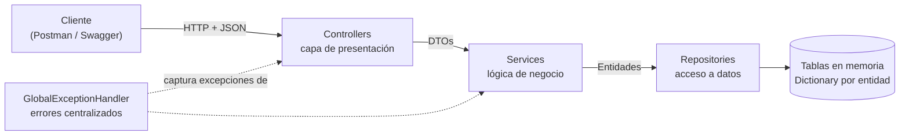
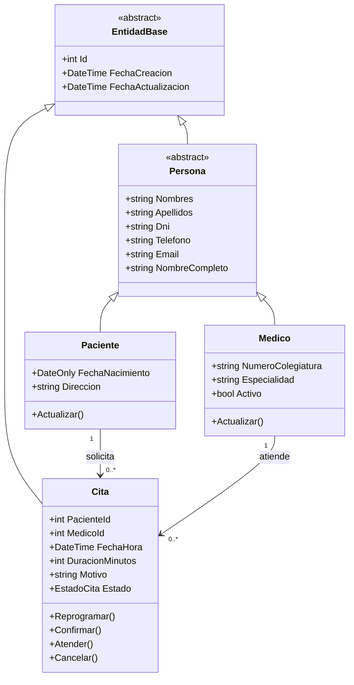
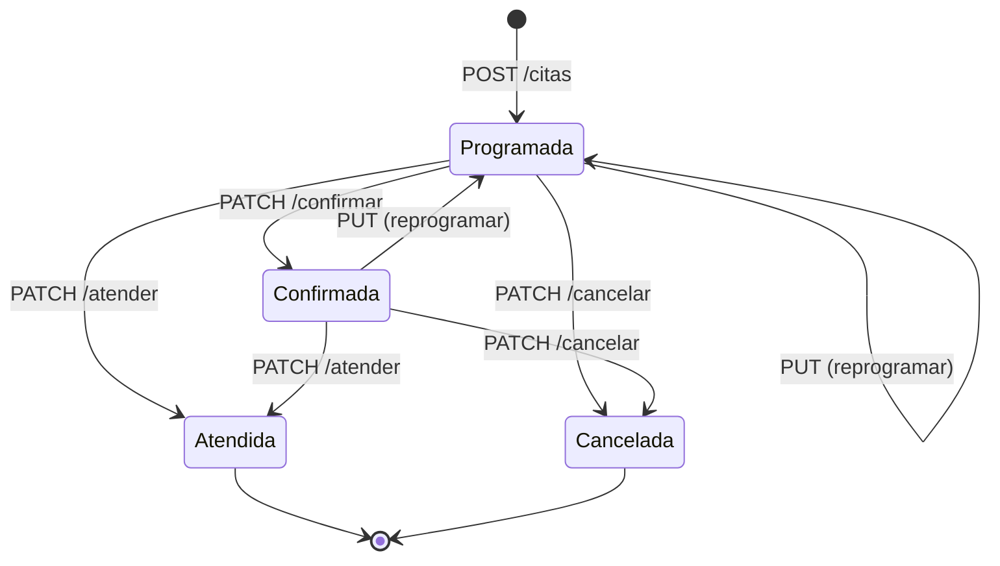

# API de Gestión de Citas Médicas

API RESTful desarrollada con **C# y .NET** para que una clínica privada pueda **registrar, consultar, reprogramar, cancelar y eliminar citas médicas** de forma ordenada, reemplazando las agendas físicas y las confirmaciones por llamada telefónica.

> **Curso:** Desarrollo de Servicios Web
> **Repositorio:** `https://github.com/omar4lzamora12-afk/ClinicaCitas`.

---

## Contenido

1. [Descripción del proyecto](#1-descripción-del-proyecto)
2. [Tecnologías](#2-tecnologías)
3. [Requisitos previos](#3-requisitos-previos)
4. [Instalación y ejecución](#4-instalación-y-ejecución)
5. [Arquitectura y estructura del proyecto](#5-arquitectura-y-estructura-del-proyecto)
6. [Modelo de clases](#6-modelo-de-clases)
7. [Endpoints de la API](#7-endpoints-de-la-api)
8. [Ejemplos de uso](#8-ejemplos-de-uso)
9. [Validaciones y reglas de negocio](#9-validaciones-y-reglas-de-negocio)
10. [Manejo de errores](#10-manejo-de-errores-centralizado)
11. [Persistencia simulada en memoria](#11-persistencia-simulada-en-memoria)
12. [Pruebas funcionales con Postman](#12-pruebas-funcionales-con-postman)
13. [Configuración](#13-configuración)
14. [Equipo y roles](#14-equipo-y-roles)
15. [Cumplimiento de la rúbrica](#15-cumplimiento-de-la-rúbrica)
16. [Solución de problemas](#16-solución-de-problemas)
17. [Mejoras futuras](#17-mejoras-futuras)

---

## 1. Descripción del proyecto

**Problema.** Las citas se anotan a mano en agendas físicas o se confirman por teléfono sin un control unificado, lo que genera confusión, pérdida de información y sobrecarga para el personal administrativo.

**Solución.** Una API REST que centraliza la gestión de **pacientes**, **médicos** y **citas**, con reglas de negocio que evitan los errores típicos de una agenda manual:

-  No se puede reservar dos veces el mismo horario con el mismo médico (ni dos citas simultáneas para un paciente).
-  Solo se atiende dentro del horario de la clínica (08:00–18:00, de lunes a sábado).
-  Las citas siguen un ciclo de vida controlado: `Programada → Confirmada → Atendida` o `Cancelada`.
-  No se pueden borrar pacientes o médicos que tengan citas (integridad referencial).
-  Todas las respuestas —de éxito y de error— tienen la misma estructura JSON.

**Sin base de datos:** según el alcance del curso, la información se guarda **en memoria** (colecciones `Dictionary`/`List`) y se reinicia al apagar la aplicación. Al iniciar se cargan datos de ejemplo para poder probar de inmediato.

## 2. Tecnologías

| Tecnología | Uso |
|---|---|
| **C# 12 / .NET 8** (ASP.NET Core Web API) | Lenguaje y framework |
| Controladores + `[ApiController]` | Endpoints REST y validación automática |
| Data Annotations (`[Required]`, `[StringLength]`, `[Range]`, `[RegularExpression]`, `[EmailAddress]`) + validaciones propias | Validación de datos de entrada |
| `IExceptionHandler` (.NET 8) | Manejo centralizado de excepciones |
| Inyección de dependencias nativa | Desacoplar capas mediante interfaces |
| **Swagger / OpenAPI** (Swashbuckle 6.6.2) | Documentación interactiva |
| **Postman / Newman** | Pruebas funcionales automatizadas |

## 3. Requisitos previos

- **.NET SDK 8.0 o superior** → verifica con `dotnet --version` ([descargar](https://dotnet.microsoft.com/download)).
- **Git** para clonar el repositorio.
- **Postman** para ejecutar la colección de pruebas, o **Node.js** para usar Newman por consola.
- Conexión a internet la primera vez (para descargar el paquete de Swagger al restaurar dependencias).

## 4. Instalación y ejecución

```bash
# 1. Clonar el repositorio
git clone https://github.com/omar4lzamora12-afk/ClinicaCitas.git
cd ClinicaCitas

# 2. Restaurar dependencias y compilar
dotnet restore
dotnet build

# 3. Ejecutar la API
dotnet run --project src/ClinicaCitas.Api
```

La API queda escuchando en **`http://localhost:5080`** y abre el navegador en la documentación Swagger.

| Recurso | URL |
|---|---|
| Documentación interactiva (Swagger UI) | http://localhost:5080/swagger |
| Estado de la API | http://localhost:5080/ |
| Pacientes / Médicos / Citas | `/api/v1/pacientes` · `/api/v1/medicos` · `/api/v1/citas` |

> Para detenerla presiona `Ctrl + C` en la terminal. Con Visual Studio, abre `ClinicaCitas.sln` y pulsa **F5**.

## 5. Arquitectura y estructura del proyecto

Arquitectura en **capas**, donde cada capa solo conoce a la siguiente **a través de interfaces**:



| Capa (carpeta = paquete) | Responsabilidad | Ejemplos |
|---|---|---|
| **`Controllers`** | Recibir la petición HTTP, delegar y devolver el código de estado correcto. **Sin lógica de negocio ni `try/catch`.** | `CitasController` |
| **`Services`** | Reglas de negocio. Exponen una **interfaz** (`ICitaService`) y una clase (`CitaService`). | `CitaService` |
| **`Repositories`** | Simulan la base de datos (CRUD sobre colecciones en memoria). | `InMemoryRepository<T>` |
| **`Models`** | Entidades del dominio con encapsulamiento (`Entities`) y enumeraciones (`Enums`). | `Cita`, `EstadoCita` |
| **`DTOs`** | Objetos de entrada/salida de la API (nunca se expone la entidad). Llevan las validaciones. | `CitaCreateRequestDto` |
| **`Exceptions`** | Excepciones de negocio con su código HTTP. | `ConflictoException` |
| **`Middleware`** | Manejo centralizado de errores. | `GlobalExceptionHandler` |
| `Validation` · `Mappings` · `Configuration` · `Extensions` · `Data` | Validaciones propias, conversión entidad→DTO, opciones, registro de dependencias, datos de ejemplo. | `FechaFuturaAttribute` |

> En .NET los "paquetes" del enunciado (`controller`, `service`, `model`) son **carpetas con su propio *namespace***.

```
ClinicaCitas/
├── ClinicaCitas.sln
├── README.md
├── docs/
│   ├── postman/                  ← colección y entorno de Postman
│   ├── evidencias/               ← resultado de la ejecución automática (Newman)
│   └── capturas/                 ← capturas de pantalla de Postman
└── src/ClinicaCitas.Api/
    ├── Program.cs                ← configuración y pipeline HTTP
    ├── appsettings.json          ← horario de la clínica y opciones
    ├── Controllers/              ← CitasController, PacientesController, MedicosController
    ├── Services/                 ← interfaces (I…Service) e implementaciones
    ├── Repositories/             ← interfaces (I…Repository) y repositorios en memoria
    ├── Models/{Entities,Enums}/  ← Cita, Paciente, Medico, Persona, EntidadBase, EstadoCita
    ├── DTOs/{Citas,Pacientes,Medicos,Common}/
    ├── Exceptions/               ← AppException y sus hijas (404, 409, 422)
    ├── Middleware/               ← GlobalExceptionHandler, RespuestasDeError
    ├── Validation/               ← validaciones personalizadas
    ├── Mappings/  Configuration/  Extensions/  Data/
```

## 6. Modelo de clases



**Principios de POO aplicados**

| Principio | Dónde se ve |
|---|---|
| **Encapsulamiento** | Las entidades tienen setters `private`; el estado de una `Cita` solo cambia con `Confirmar()`, `Cancelar()`… que validan que la transición sea legal. |
| **Abstracción** | `EntidadBase` y `Persona` son abstractas; los servicios y repositorios se usan siempre a través de **interfaces**. |
| **Herencia / reutilización** | `Paciente` y `Medico` heredan de `Persona`; `InMemoryRepository<T>` (genérico) es reutilizado por los tres repositorios; los DTOs de cita comparten `CitaBaseRequestDto`. |
| **Polimorfismo** | Los controladores dependen de `ICitaService`, no de `CitaService`: se puede sustituir la implementación sin tocar el controlador. |

**Ciclo de vida de una cita**



## 7. Endpoints de la API

Prefijo común: `/api/v1`. Los cuerpos de solicitud y respuesta son JSON.

### Citas — `/api/v1/citas`

| Método | Ruta | Descripción | Éxito | Errores posibles |
|---|---|---|---|---|
| `GET` | `/citas` | Lista citas. Filtros opcionales: `?fecha=AAAA-MM-DD&estado=&medicoId=&pacienteId=` | 200 | 400 |
| `GET` | `/citas/{id}` | Obtiene una cita | 200 | 400, 404 |
| `POST` | `/citas` | Registra una cita (nace *Programada*) | **201** + `Location` | 400, 404, 409, 422 |
| `PUT` | `/citas/{id}` | Reprograma una cita vigente | 200 | 400, 404, 409, 422 |
| `PATCH` | `/citas/{id}/confirmar` | Programada → Confirmada | 200 | 404, 409 |
| `PATCH` | `/citas/{id}/atender` | → Atendida (estado final) | 200 | 404, 409 |
| `PATCH` | `/citas/{id}/cancelar` | → Cancelada (exige motivo) | 200 | 400, 404, 409 |
| `DELETE` | `/citas/{id}` | Elimina la cita definitivamente | **204** | 404, 409 |

### Pacientes — `/api/v1/pacientes`

| Método | Ruta | Descripción | Éxito | Errores posibles |
|---|---|---|---|---|
| `GET` | `/pacientes` | Lista pacientes | 200 | — |
| `GET` | `/pacientes/{id}` | Obtiene un paciente | 200 | 400, 404 |
| `POST` | `/pacientes` | Registra un paciente | **201** + `Location` | 400, 409 |
| `PUT` | `/pacientes/{id}` | Reemplaza los datos | 200 | 400, 404, 409 |
| `DELETE` | `/pacientes/{id}` | Elimina (si no tiene citas) | **204** | 404, 409 |
| `GET` | `/pacientes/{pacienteId}/citas` | **Ruta jerárquica:** citas del paciente (`?estado=`) | 200 | 404 |

### Médicos — `/api/v1/medicos`

| Método | Ruta | Descripción | Éxito | Errores posibles |
|---|---|---|---|---|
| `GET` | `/medicos` | Lista médicos. Filtro opcional `?especialidad=` | 200 | — |
| `GET` | `/medicos/{id}` | Obtiene un médico | 200 | 400, 404 |
| `POST` | `/medicos` | Registra un médico | **201** + `Location` | 400, 409 |
| `PUT` | `/medicos/{id}` | Reemplaza los datos (también activa/desactiva) | 200 | 400, 404, 409 |
| `DELETE` | `/medicos/{id}` | Elimina (si no tiene citas) | **204** | 404, 409 |
| `GET` | `/medicos/{medicoId}/citas` | **Ruta jerárquica:** agenda del médico (`?fecha=`) | 200 | 404 |

> **¿Cancelar o eliminar?** *Cancelar* conserva el registro (estado `Cancelada` + motivo) y sirve para el historial. *Eliminar* (`DELETE`) lo borra; no se permite sobre citas *Atendidas* porque forman parte del historial clínico.

## 8. Ejemplos de uso

### Registrar una cita — `POST /api/v1/citas`

```http
POST /api/v1/citas HTTP/1.1
Content-Type: application/json

{
  "pacienteId": 1,
  "medicoId": 1,
  "fechaHora": "2026-11-10T09:30:00",
  "duracionMinutos": 30,
  "motivo": "Dolor de cabeza persistente",
  "observaciones": "Primera consulta"
}
```

**Respuesta `201 Created`** (cabecera `Location: http://localhost:5080/api/v1/citas/4`)

```json
{
  "exito": true,
  "mensaje": "Cita registrada correctamente.",
  "datos": {
    "id": 4,
    "pacienteId": 1,
    "paciente": "Lucía Fernández Rojas",
    "medicoId": 1,
    "medico": "Ricardo Salazar Paredes",
    "especialidad": "Medicina General",
    "fechaHora": "2026-11-10T09:30:00",
    "fechaFin": "2026-11-10T10:00:00",
    "duracionMinutos": 30,
    "motivo": "Dolor de cabeza persistente",
    "observaciones": "Primera consulta",
    "estado": "Programada",
    "fechaCreacion": "2026-10-17T12:29:04.2242143"
  },
  "marcaDeTiempo": "2026-10-17T12:29:04.2279345+00:00"
}
```

### Error de validación — `400 Bad Request`

```json
{
  "exito": false,
  "codigoEstado": 400,
  "titulo": "Error de validación",
  "mensaje": "Uno o más campos no cumplen las reglas de validación. Revise el detalle en 'errores'.",
  "errores": {
    "dni": ["El DNI debe tener exactamente 8 dígitos numéricos."],
    "email": ["El correo electrónico no tiene un formato válido."],
    "fechaNacimiento": ["La fecha de nacimiento debe estar entre el 01/01/1900 y la fecha de hoy."]
  },
  "ruta": "/api/v1/pacientes",
  "idTraza": "0HNPC98OP5NL8:00000001",
  "marcaDeTiempo": "2026-10-17T12:29:03.7953256+00:00"
}
```

### Horario ocupado — `409 Conflict`

```json
{
  "exito": false,
  "codigoEstado": 409,
  "titulo": "Conflicto con el estado actual del recurso",
  "mensaje": "El médico ya tiene una cita vigente que se cruza con ese horario. Elija otra hora u otro médico.",
  "ruta": "/api/v1/citas",
  "idTraza": "0HNPC98OP5NLH:00000001",
  "marcaDeTiempo": "2026-10-17T12:29:04.2868234+00:00"
}
```

### Cancelar una cita — `PATCH /api/v1/citas/4/cancelar`

```json
{ "motivo": "El paciente no puede asistir" }
```

### Con `curl`

```bash
curl http://localhost:5080/api/v1/citas                                   # listar
curl "http://localhost:5080/api/v1/citas?estado=Programada&medicoId=1"    # filtrar
curl http://localhost:5080/api/v1/medicos/1/citas                         # agenda de un médico
curl -X PATCH http://localhost:5080/api/v1/citas/1/confirmar             # confirmar
curl -X DELETE http://localhost:5080/api/v1/citas/1                      # eliminar (204)
```

### Datos de ejemplo precargados

Al iniciar se crean **3 pacientes, 3 médicos y 3 citas** (con fechas calculadas a partir de hoy, de modo que nunca quedan en el pasado). Se desactiva con `"SembrarDatosDePrueba": false` en `appsettings.json`.

## 9. Validaciones y reglas de negocio

### Validación de datos de entrada (DTOs → `400`)

| Campo | Regla |
|---|---|
| `nombres`, `apellidos` | Obligatorio, 2–80 caracteres, solo letras, espacios, apóstrofes, puntos y guiones |
| `dni` | Obligatorio, exactamente 8 dígitos |
| `telefono` | Obligatorio, celular peruano de 9 dígitos que empieza con 9 |
| `email` | Obligatorio, formato válido, máx. 100 caracteres |
| `fechaNacimiento` | Obligatoria, entre 01/01/1900 y hoy (`[FechaNoFutura]`, validación propia) |
| `numeroColegiatura` | Obligatorio, 5 o 6 dígitos |
| `especialidad` | Obligatoria, 3–60 caracteres |
| `pacienteId`, `medicoId` | Número entero mayor que 0 |
| `fechaHora` (cita) | Obligatoria y **futura** (`[FechaFutura]`, validación propia) |
| `duracionMinutos` | Opcional, entre 15 y 120 (por defecto 30) |
| `motivo` (cita / cancelación) | Obligatorio, 5–250 caracteres |

### Reglas de negocio (servicios → `404`, `409`, `422`)

| Regla | Código |
|---|---|
| El paciente y el médico de una cita deben existir | `404` |
| El médico debe estar **activo** para recibir citas | `422` |
| La cita debe estar dentro del horario de atención (08:00–18:00) y terminar antes del cierre | `422` |
| La clínica no atiende los domingos | `422` |
| El médico no puede tener dos citas vigentes que se crucen | `409` |
| El paciente no puede tener dos citas vigentes que se crucen | `409` |
| Transiciones de estado válidas (ver diagrama); `Atendida` y `Cancelada` son finales | `409` |
| No se puede eliminar una cita *Atendida* (historial clínico) | `409` |
| DNI de paciente único; DNI y colegiatura de médico únicos | `409` |
| No se puede eliminar un paciente o médico que tenga citas | `409` |

## 10. Manejo de errores centralizado

`GlobalExceptionHandler` (`IExceptionHandler` de .NET 8) atrapa **todas** las excepciones en un solo lugar, por lo que controladores y servicios no necesitan `try/catch`. Los servicios simplemente lanzan excepciones de negocio y el manejador las traduce a HTTP:

| Excepción | Código | Cuándo |
|---|---|---|
| *(validación de DTO)* | **400** Bad Request | Datos inválidos, JSON mal formado, tipos incorrectos |
| `RecursoNoEncontradoException` | **404** Not Found | El recurso no existe |
| `ConflictoException` | **409** Conflict | Duplicados, horario ocupado, estado no permitido, dependencias |
| `ReglaDeNegocioException` | **422** Unprocessable Entity | Datos válidos que incumplen una regla del negocio |
| *(cualquier otra)* | **500** Internal Server Error | Error inesperado: mensaje genérico al cliente; el detalle técnico solo va al *log* |
| *(framework)* | 404 · 405 · 415 | Ruta inexistente, método no permitido, tipo de contenido no soportado |

Incluso los errores del propio framework (ruta inexistente, `Content-Type` incorrecto…) salen con la **misma estructura** (`exito`, `codigoEstado`, `titulo`, `mensaje`, `errores`, `ruta`, `idTraza`, `marcaDeTiempo`). Los mensajes técnicos en inglés del framework se reemplazan por mensajes claros en español.

## 11. Persistencia simulada en memoria

`InMemoryRepository<TEntidad>` imita una tabla de base de datos usando un mapa `Dictionary<int, TEntidad>` (clave primaria → fila). Los listados se entregan como `List<T>`.

| Comportamiento de una BD real | Cómo se simula |
|---|---|
| Columna `IDENTITY` | Id autoincremental que nunca se reutiliza |
| Filas independientes | El repositorio entrega y guarda **copias**: modificar un objeto no cambia los datos hasta llamar a `Actualizar()`. Si una validación falla a mitad de camino, no queda nada a medias |
| Restricción `UNIQUE` | Verificada en los servicios (DNI, colegiatura) |
| Clave foránea | Una cita exige paciente y médico existentes; no se pueden borrar si tienen citas |
| Columnas de auditoría | `FechaCreacion` y `FechaActualizacion` las asigna la capa de datos |
| Transacciones | `TransaccionSimulada` serializa las operaciones "verificar + guardar": evita que dos peticiones simultáneas reserven el mismo horario (se comprobó con 20 peticiones concurrentes al mismo horario: **1 × 201 y 19 × 409**) |
| Concurrencia | `lock` en cada repositorio |

Gracias a la interfaz `IRepository<T>`, esta capa se puede reemplazar por Entity Framework Core + SQL Server **sin modificar servicios ni controladores**.

## 12. Pruebas funcionales con Postman

La carpeta [`docs/postman`](docs/postman) contiene:

- `ClinicaCitas.postman_collection.json` — **58 peticiones** organizadas en 5 carpetas, cada una con **pruebas automáticas** (pestaña *Tests*).
- `ClinicaCitas.local.postman_environment.json` — entorno con `baseUrl = http://localhost:5080`.

**Cómo ejecutarlas en Postman**

1. Levanta la API (`dotnet run --project src/ClinicaCitas.Api`).
2. En Postman: **Import** → selecciona los dos archivos de `docs/postman`.
3. Elige el entorno **ClinicaCitas.local**.
4. Haz clic derecho en la colección → **Run collection** → **Run**. Se ejecutan las 58 peticiones en orden y se muestran los *tests* en verde.

**Cómo ejecutarlas por consola (Newman)**

```bash
npm install -g newman
newman run docs/postman/ClinicaCitas.postman_collection.json \
       -e docs/postman/ClinicaCitas.local.postman_environment.json
```

**Qué cubre la colección**

| Carpeta | Peticiones | Qué verifica |
|---|---|---|
| 00 · Información general | 1 | La API está en línea |
| 01 · Pacientes | 11 | CRUD completo, `201` + `Location`, `204`, validaciones `400`, duplicado `409`, `404` |
| 02 · Médicos | 11 | CRUD, filtro por especialidad, colegiatura duplicada, eliminación |
| 03 · Citas | 28 | Flujo completo: registrar → listar/filtrar → reprogramar → confirmar → cancelar → eliminar → atender; horario ocupado `409`, fuera de horario `422`, domingo `422`, fecha pasada `400`, rutas jerárquicas, integridad referencial |
| 04 · Manejo centralizado de errores | 7 | JSON mal formado, tipo incorrecto, sin cuerpo, `405`, `415`, ruta inexistente |

**Resultado de la última ejecución** (detalle completo en [`docs/evidencias/resultado-newman.txt`](docs/evidencias/resultado-newman.txt)):

| Peticiones | Aserciones | Fallidas | Tiempo promedio de respuesta |
|---|---|---|---|
| 58 | 276 | **0** | 2 ms |

> Las fechas, DNI y colegiaturas se **generan dinámicamente** en cada ejecución, así que la colección puede correrse varias veces seguidas (se verificó con 3 iteraciones consecutivas: 828 aserciones, 0 fallos).

### 📸 Capturas de las pruebas

Guarda aquí las capturas tomadas en Postman (carpeta [`docs/capturas`](docs/capturas)):

| Captura | Qué debe mostrar |
|---|---|
| `01-collection-runner.png` | Resultado del *Collection Runner* (58 peticiones, tests en verde) |
| `02-registrar-cita-201.png` | `POST /citas` → 201 con el cuerpo y la cabecera `Location` |
| `03-horario-ocupado-409.png` | `POST /citas` en horario ocupado → 409 |
| `04-validacion-400.png` | Error de validación con el detalle por campo |
| `05-swagger.png` | Swagger UI con todos los endpoints |

## 13. Configuración

Parámetros de la clínica en `src/ClinicaCitas.Api/appsettings.json` (sección `Clinica`); se pueden cambiar **sin recompilar**:

```json
"Clinica": {
  "Nombre": "Clínica Salud Integral",
  "HoraApertura": "08:00:00",
  "HoraCierre": "18:00:00",
  "DuracionCitaPorDefectoMinutos": 30,
  "AtiendeDomingos": false,
  "SembrarDatosDePrueba": true
}
```

El puerto se define en `src/ClinicaCitas.Api/Properties/launchSettings.json` (por defecto `5080`).

**Nota sobre fechas:** `fechaHora` se envía en hora local de la clínica y **sin zona horaria** (`2026-11-10T09:30:00`).

## 14. Equipo y roles

| Integrante | Rol | Responsabilidades |
|---|---|---|
| *[Nombre completo 1]* | Modelos y persistencia | Entidades (`Models`), repositorios en memoria, datos de ejemplo |
| *[Nombre completo 2]* | Lógica de negocio | Servicios, reglas de negocio, excepciones y manejo centralizado de errores |
| *[Nombre completo 3]* | API, pruebas y documentación | Controladores, DTOs y validaciones, Swagger, colección de Postman, README e informe |


## 15. Cumplimiento de la rúbrica

| Criterio de la rúbrica | Dónde se evidencia |
|---|---|
| **Programación orientada a objetos con C#** | Encapsulamiento (setters privados, métodos de dominio en `Cita`), abstracción (`EntidadBase`, `Persona`, interfaces), herencia y reutilización (`Persona`, `InMemoryRepository<T>`, `CitaBaseRequestDto`), código documentado con comentarios XML → [`Models/`](src/ClinicaCitas.Api/Models) |
| **Estructura del proyecto y organización de componentes** | Capas Controller → Service → Repository, lógica de negocio en servicios independientes mediante interfaces, DTOs de entrada/salida → sección [5](#5-arquitectura-y-estructura-del-proyecto) |
| **Creación de APIs RESTful** | CRUD completo (GET/POST/PUT/PATCH/DELETE), rutas jerárquicas (`/pacientes/{id}/citas`), validaciones avanzadas, manejo centralizado de excepciones, respuestas con estructura consistente y códigos HTTP contextualizados → secciones [7](#7-endpoints-de-la-api), [9](#9-validaciones-y-reglas-de-negocio) y [10](#10-manejo-de-errores-centralizado) |
| **Simulación de persistencia local** | `InMemoryRepository<T>` con ids autoincrementales, copias de filas, integridad referencial y transacciones simuladas, controlado desde los servicios → sección [11](#11-persistencia-simulada-en-memoria) |
| **Documentación y pruebas del sistema** | Este README, Swagger (`/swagger`), colección de Postman con tests automáticos, ejemplos de uso y evidencias → secciones [4](#4-instalación-y-ejecución), [8](#8-ejemplos-de-uso) y [12](#12-pruebas-funcionales-con-postman) |

## 16. Solución de problemas

| Problema | Solución |
|---|---|
| `You must install or update .NET to run this application` | Instala el **SDK 8.0** o superior. El proyecto está configurado para ejecutarse también con runtimes 9 y 10 (`RollForward`) |
| `dotnet restore` falla por falta de internet | La primera restauración descarga Swashbuckle (Swagger) desde NuGet. Conéctate a internet o, si no es posible, elimina el `PackageReference` de `ClinicaCitas.Api.csproj`, el archivo `Extensions/SwaggerExtensions.cs` y las dos líneas de Swagger en `Program.cs` |
| `Address already in use` (puerto ocupado) | Cambia `applicationUrl` en `launchSettings.json` y el valor de `baseUrl` en el entorno de Postman |
| Los datos desaparecieron al reiniciar | Es lo esperado: la persistencia es **solo en memoria** |
| Un `POST /citas` devuelve `400` por fecha | La fecha de la cita debe ser **futura**; si usas ejemplos con fechas fijas, ajústalas |
| Quiero usar HTTPS | `dotnet dev-certs https --trust` y luego `dotnet run --project src/ClinicaCitas.Api --launch-profile https` |

## 17. Mejoras futuras

- Reemplazar la capa de repositorios por **Entity Framework Core** con SQL Server o PostgreSQL.
- **Autenticación y autorización** con JWT y roles (administrativo, médico).
- **Paginación** y ordenamiento en los listados.
- Consulta de **disponibilidad** de un médico (horarios libres de un día).
- **Pruebas unitarias** con xUnit para servicios y entidades.
- Notificaciones de recordatorio por correo o SMS.